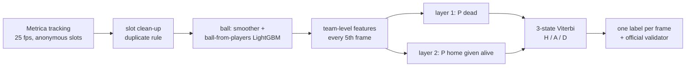

# Visca Barca – More than a Hack 2027: ball possession

Our entry for **More than a Hack 2027, Phase 1: ball possession** (Metrica Sports × FC Barcelona × MWCapital).

- **Task:** one label per frame of FC Barcelona vs Athletic Club: H (home), A (away), D (dead ball) or X (no answer).
- **Model:** C3-T, a team-level two-layer LightGBM with a 3-state Viterbi decoder.
- **Training data:** PFF FC World Cup 2022 tracking, degraded to look like Metrica's automatic tracking. The hackathon
  match is never used for training.

**Team:** Zeyad Khaled, Ahmed Hassan, Omar Essam.

Method, data and evaluation in detail: [docs/technical.md](docs/technical.md).

## Pipeline



Training follows the same path on PFF World Cup 2022. The PFF tracking is first degraded with rates measured on the
hackathon match: 25 fps, broken and swapped slots, a missing ball and extra slots.

## Results

spellF1 is the competition metric and macroF1 is the tie-break. Both are means per match, from our scorer, which equals
the official one when the prediction has no X (`scripts/check_scorer_parity.py`).

| evaluation | input | spellF1 | macroF1 |
|---|---|---|---|
| 5-fold CV, 30 PFF learning matches | clean | 0.645 | 0.912 |
| 5-fold CV, 30 PFF learning matches | degraded | 0.615 | 0.902 |
| 6 PFF stress matches, never trained on | clean | 0.584 | 0.889 |
| 6 PFF stress matches, never trained on | degraded | 0.554 | 0.879 |
| 16 locked PFF test matches, run once at the end | degraded | 0.617 (95% CI 0.598–0.636) | 0.902 |
| 16 locked PFF test matches, run once at the end | clean | 0.644 (95% CI 0.624–0.665) | 0.911 |
| hackathon match, public 5 minutes, official scorer (a check only, never used to choose) | real | 0.539 | 0.908 |
| official `baseline_smooth125`, same 5 minutes | real | 0.424 | 0.581 |

## Reproduce the submission

1. **Clone** with the official repo as a submodule. It provides the readers and the validator.

   ```bash
   git clone --recurse-submodules https://github.com/zeyadkkhaled/barca-possession-hack.git
   cd barca-possession-hack
   ```

2. **Install** into Python 3.13:

   ```bash
   python -m venv .venv
   .venv/Scripts/python -m pip install -r requirements.txt     # Linux / macOS: .venv/bin/python
   ```

3. **Data path:** put the hackathon bundle in `data/` with the layout of `reference/more-than-a-hack-2027/DATA.md`. The
   unpacked download folder `data/More Than A Hack 2027 - Initial Challenge - Dataset/` is also found. Otherwise set
   `MTAH_DATA_DIR` to the folder that holds `tactical/`.

4. **Run:**

   ```bash
   python run.py --out outputs/submission_c3.csv
   ```

   - It writes `outputs/submission_c3.csv` (199,319 rows) and runs the official validator.
   - It does no training: it uses the committed models in `models/c3/` and `models/bfp/`.
   - Expected sha256: `8612514a69e9c58045ab5c0ccdad20808aa48bdfd45d0566f8389eb43defa8c5`.
   - It takes about 30 s on a laptop CPU, with a peak of 0.6 GB RAM.
   - It is deterministic: LightGBM prediction on CPU.

Tests: `python -m pytest`. On Windows, set `PYTHONUTF8=1`.

## Repository layout

```
run.py                       one command: hackathon data + committed models -> submission CSV + validator
models/c3, models/bfp        the frozen C3-T and ball-from-players LightGBM models (text files)
src/barca_possession/        loader and noise statistics, ball smoother + ball fill, C3-T features / layers / decoder,
                             post-rules, splits, the earlier C0-C3 rule-based and per-player baselines
src/barca_train/             PFF degradation (degrade_pff), training / scoring pipeline, stress-match loader
src/barca_labels/            PFF answer key (labels v2) and the H/A/D scorer
scripts/                     training, CV and evaluation (aggregate numbers only):
                             cv_c3t.py, fit_predict.py, ballfill_eval.py, stress_eval.py, locked_test.py,
                             extra_slot_diag.py, check_scorer_parity.py; data/ builds the PFF packages
reports/auto/                aggregate results (JSON) behind every number in this README
docs/                        technical.md, HACKATHON_RULES.md, PROVENANCE.md, dev_log/ (step reports, locked-test log)
reference/more-than-a-hack-2027/   the official repo (git submodule): readers, scorer, validator, public 5-min GT
tests/                       unit tests
data/, outputs/              git-ignored: hackathon data and generated files are never committed
```

## Training data

The training data is the **PFF FC FIFA World Cup 2022** dataset (tracking, events, rosters), which PFF FC released free.
- We built the answer key (labels v2) from PFF's events with the code in `src/barca_labels/`.
- The 64 matches are split into 30 learning matches (5 folds), 16 locked test matches and 18 stress matches (6 used as
  an outside check).
- No PFF data is in this repository.

The way to obtain the data and how the training is run are in [docs/technical.md](docs/technical.md).

## Licence and credits

- Code: MIT, see [LICENSE](LICENSE). Copyright Visca Barca 2026.
- **Hackathon data:** Metrica Sports and the Barça Innovation Hub, licensed for the competition only. It is not included.
- **PFF FC:** the World Cup 2022 tracking and event data used for training. It is not included.
- **kloppy:** the open-source library the official data guide uses for Metrica's EPTS format.
- **LightGBM:** the gradient-boosting library for every model here.
- **The official More than a Hack 2027 repository:** readers, scorer and validator (submodule, its own licence).
